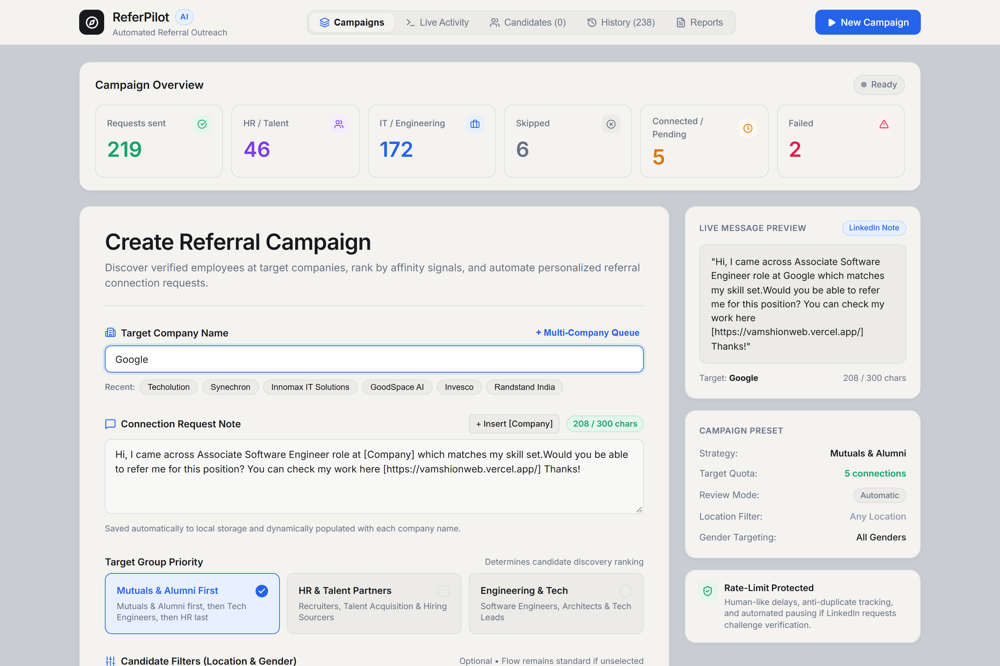
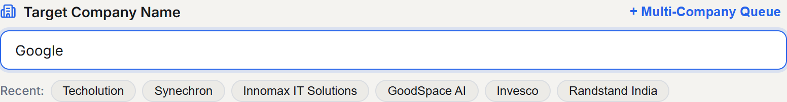
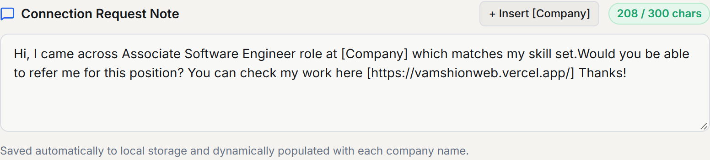
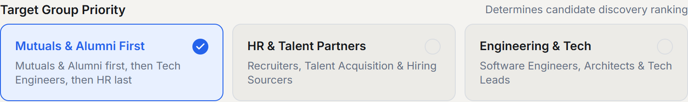
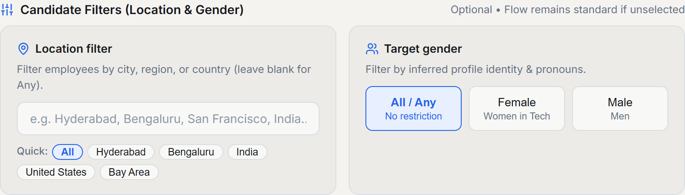
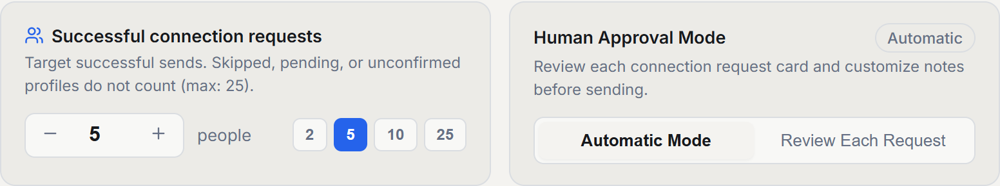
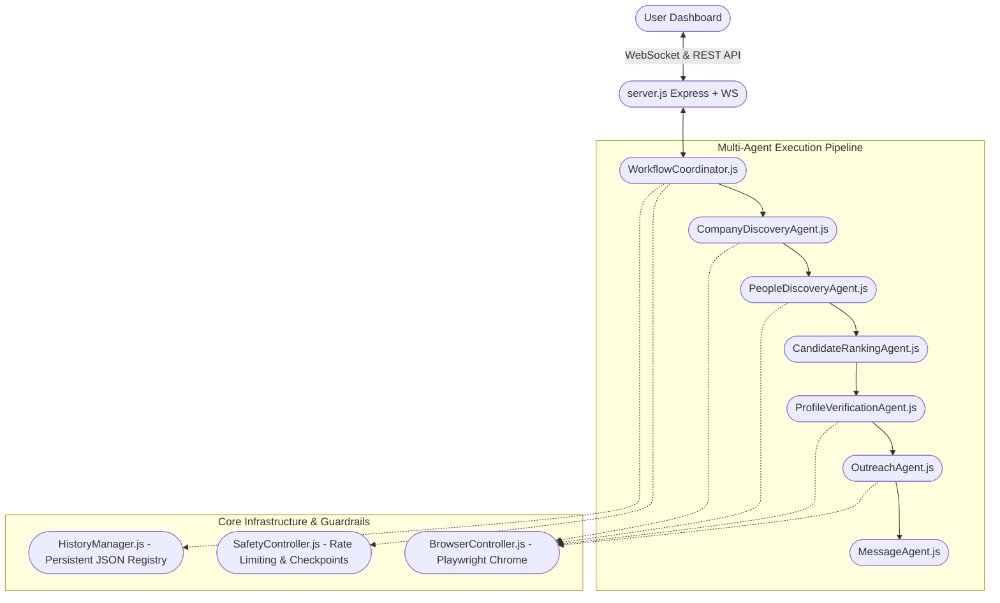

<div align="center">

# 🧭 ReferPilot
### AI-Powered LinkedIn Referral Outreach & Intelligent Candidate Networking Platform

[](https://nodejs.org)
[](https://playwright.dev)
[](https://react.dev)
[](https://vitejs.dev)
[](https://expressjs.com)
[](LICENSE)

*An autonomous, safety-first AI agent designed for high-conversion referral outreach. Discovers verified official company pages, identifies high-affinity employees, applies strict role exclusions (bypassing interns and trainees), ranks prospects with deterministic heuristics, and coordinates personalized connection notes with human-in-the-loop review.*

[Simple Flow](#-how-referpilot-works-in-4-simple-steps) • [UI Options Tour](#-frontend-user-interface--options-tour) • [Features](#-key-features) • [Architecture](#-system-architecture) • [Getting Started](#-getting-started) • [Safety First](#-safety--account-protection)

</div>

---

## ⚡ How ReferPilot Works in 4 Simple Steps

The entire referral generation workflow is streamlined into four intuitive steps:

```
┌─────────────────┐       ┌────────────────────┐       ┌────────────────────────┐       ┌───────────────────────┐
│ 1. Find an      │  ───> │ 2. Give the        │  ───> │ 3. Drop Your Message   │  ───> │ 4. Select Preferences │
│    Opening      │       │    Company Name    │       │    (Use Template Note) │       │    & Launch Outreach  │
└─────────────────┘       └────────────────────┘       └────────────────────────┘       └───────────────────────┘
```

### 1. 🔍 Find an Opening
Spot an active job vacancy or career opportunity that matches your skillset on LinkedIn, a company careers site, or a job board (e.g., *Associate Software Engineer*, *Full Stack Developer*, *Data Scientist*).

### 2. 🏢 Give the Company Name
Enter the target company name (e.g. **Google**, **Microsoft**, **Invesco**, **Techolution**) into ReferPilot.
* **Single Company Mode**: Target one company with focused outreach.
* **Multi-Company Queue**: Process multiple companies sequentially without mixing candidate pools.
* **Smart Disambiguation**: The agent automatically identifies and validates the official company LinkedIn page, filtering out fan pages and third-party staffing agencies.

### 3. ✍️ Drop Your Message (Use Template Note)
Input your connection request message. ReferPilot automatically swaps `[Company]` with the target company's name for every prospect:

> **Recommended Template Message:**
> ```text
> Hi, I came across Associate Software Engineer role at [Company] which matches my skill set.Would you be able to refer me for this position? You can check my work here [https://vamshionweb.vercel.app/] Thanks!
> ```

* **Dynamic `[Company]` Token**: One-click insert button dynamically populates each company's exact title.
* **Character Limit Guard**: Real-time counter strictly enforces LinkedIn's 300-character connection note limit so your invitations are never truncated or rejected.
* **Local Auto-Save**: Your message is safely remembered in local storage across browser refreshes.

### 4. ⚙️ Select Your Preferences & Launch
Configure candidate filtering heuristics to match your referral strategy:
* **Target Group Priority**:
  * **Mutuals & Alumni First (Recommended)**: Prioritizes shared 2nd-degree connections and college alumni first, then tech engineers, and HR partners last (`Mutuals ➔ Tech Engineers ➔ Last HR`).
  * **Engineering & Tech**: Focuses outreach directly on Software Engineers, Tech Leads, and Engineering Managers.
  * **HR & Talent Partners**: Focuses outreach on Technical Recruiters and Talent Acquisition Leads.
* **Candidate Filters**:
  * **Location Filter**: Narrow prospects by city, region, or country (e.g., *Hyderabad*, *Bengaluru*, *India*, *Bay Area*).
  * **Target Gender Filter**: Inferred identity filter for balanced diversity or targeted initiatives (e.g., *Women in Tech*).
* **Connection Limit**: Set target successful sends per company (1–25) to stay within LinkedIn safe limits.
* **Approval Mode**: Choose between **Human-in-the-Loop Review** (inspect each card and tweak notes before sending) or **Automatic Mode**.

---

## 🖥️ Frontend User Interface & Options Tour

ReferPilot features an enterprise-grade light interface built with React 19, Vite, and Lucide icons.

### 1. Full Campaign Workspace Overview
The central dashboard provides the campaign setup form on the left and a live real-time note preview card on the right.



---

### 2. Target Company Input
Enter a single target organization or switch to sequential multi-company batch queue. Quick-pick chips allow instant re-use of recent target companies.



---

### 3. Connection Request Note & Dynamic Template
Draft your personalized invitation note with live character counting (capped at 300 characters), token insertion, and instant preview.



---

### 4. Target Group Priority Ranking
Determines the candidate ranking order. The default heuristic systematically contacts warm mutuals and alumni first, then active engineering peers, placing recruiters last.



---

### 5. Candidate Filters (Location & Gender)
Filter company employees by geographic office location and inferred pronouns/gender without altering the underlying discovery engine.



---

### 6. Outreach Limits & Approval Modes
Control how many successful invitations to send per company and toggle between human approval review and automated delivery.



---

## 🌟 Key Features

### 1. 🎯 Intelligent Affinity Targeting & Priority Order
- **Mutuals & Alumni First Heuristic**: Highest referral response rate. Shared mutual connections and college alumni have built-in trust and rapport.
- **Priority Fallback**: `Mutuals & Alumni ➔ Tech Engineers ➔ Last HR / Talent Partners`.
- **Strict Role Exclusions (Zero Quota Wasted)**:
  - **Interns & Trainees Strictly Excluded**: Automated filters block `intern`, `trainee`, `student`, `apprentice`, `fresher`, and `co-op` roles—even if the title mentions *"engineer"* (e.g., *"Graduate Engineer Trainee"* or *"Software Engineering Intern"*).
  - **No False Alumni Bypasses**: Generic mentions of universities on a student's card can no longer bypass intern restrictions.
  - **Unrelated Departments Filtered**: Pure Sales, Marketing, Legal, Finance, and Administrative roles are filtered out.

### 2. 🛡️ Safety-First & Zero-Bypass Policy
- **Zero Bot Checkpoint Bypasses**: Never attempts to bypass CAPTCHAs, 2FA, or verification screens. If LinkedIn triggers a challenge, the agent pauses immediately and alerts the dashboard for manual resolution.
- **Persistent Native Chrome Session**: Runs via your authentic Google Chrome browser using a persistent profile directory (`data/chrome_profile`). Once logged in, your session remains active without re-authenticating.
- **Humanized Interaction Jitter**: Natural, randomized pauses (3–8s) between clicks and typing simulate human cadence.
- **Chat Dock Avoidance**: Automatically detects and ignores floating LinkedIn messaging drawers, targeting strictly within official invitation dialogs.

### 3. 👥 Human-in-the-Loop (HITL) Review Mode
- Review candidate cards before sending: inspect profile avatar, verified current job title, relevance score, and personalized note.
- **Inline Note Editing**: Adjust or customize notes on the fly before clicking Approve.
- **Granular Actions**: Approve & Send, Skip Candidate, or Stop Campaign at any point.

### 4. 🏢 Company Verification & Disambiguation
- Discovers and validates official company pages against unofficial fan groups, training institutes, and subsidiaries.
- Displays follower counts, official website, industry, and employee breakdown (HR count, IT count, Mutuals count) before outreach begins.

### 5. 💾 Cross-Session Deduplication & Export
- Persistent memory in `data/history.json` ensures you **never** contact the same person twice, even months later or across different campaigns.
- One-click CSV export for integration into spreadsheets or CRM pipelines.

---

## 🏗 System Architecture

ReferPilot uses a modular **Multi-Agent Architecture** coordinated by a central orchestrator:



### Module Responsibilities:
- **`WorkflowCoordinator`**: Central orchestrator managing the multi-stage campaign lifecycle and WebSocket event broadcasting.
- **`CompanyDiscoveryAgent`**: Discovers and validates official LinkedIn company pages.
- **`PeopleDiscoveryAgent`**: Navigates the `/people/` section, searches keywords, and harvests employee cards.
- **`CandidateRankingAgent`**: Deterministic scoring heuristic prioritizing Mutuals ➔ Tech Engineers ➔ HR, enforcing intern/trainee restrictions.
- **`ProfileVerificationAgent`**: Validates current employment and active job titles directly on candidate profiles.
- **`MessageAgent`**: Performs token substitution (`[Company]`), enforces LinkedIn note limit (<300 chars).
- **`OutreachAgent`**: Scopes into the LinkedIn invitation modal, enters notes, avoids chat docks, and triggers Send.
- **`BrowserController`**: Manages Playwright persistent Chrome contexts and native binary discovery across Windows, macOS, and Linux.
- **`SafetyController`**: Enforces session rate caps and listens for security checkpoints.
- **`HistoryManager`**: Local JSON storage preventing duplicate outreach across campaigns.

---

## 🚀 Getting Started

### Prerequisites

- **Node.js** v18 or higher (tested on Node v20 & v24)
- **Google Chrome** installed (auto-detected on Windows `C:\Program Files\Google\Chrome\Application\chrome.exe` and macOS `/Applications/Google Chrome.app`).

### Installation

1. **Clone the repository**:
   ```bash
   git clone https://github.com/VamshiMudiraj05/Referral-Agent-LinkedIn.git
   cd Referral-Agent-LinkedIn
   ```

2. **Install backend dependencies**:
   ```bash
   npm install
   ```

3. **Install frontend dependencies & build bundle**:
   ```bash
   cd frontend
   npm install
   npm run build
   cd ..
   ```

### Running the Application

1. **Start the application**:
   ```bash
   npm start
   # or for development
   npm run dev
   ```

2. **Open the Dashboard**:
   Open **[http://localhost:3001](http://localhost:3001)** in your web browser.

3. **Initial Login Setup**:
   - On the first campaign launch, Google Chrome will open.
   - If prompted by LinkedIn to log in, sign in manually in the visible Chrome window.
   - ReferPilot saves your authentication session in `data/chrome_profile/` so you won't need to log in again on future runs.

---

## 🧪 Automated Unit Testing

The automated test suite verifies candidate ranking heuristics, intern/trainee exclusions, priority orders, token substitutions, safety rate limiters, and history deduplication:

```bash
npm test
```

Expected output:
```text
✓ Extracted clean first name from profiles
✓ Generated personalized message with [Company] token
✓ Excluded pure sales role: Enterprise Account Executive
✓ Excluded finance role: Finance & Payroll Specialist
✓ Excluded technical intern role: Software Engineering Intern
✓ Excluded engineering trainee role: Graduate Engineer Trainee
✓ Excluded student role: Student at JNTU College | Aspiring Developer
✓ Ranked Candidates Priority Order: Mutuals -> Tech Engineers -> Last HR
✓ Enforced max requests per company limit
✓ Enforced cross-session duplicate protection
✓ Cleanly isolated Location and Gender filters
✓ Three-dot Connect path fills the note and clicks Send only after validating it
✨ ALL TESTS PASSED SUCCESSFULLY! ✨
```

---

## 📁 Project Structure

```text
LinkedIn-Referral-AI-Agent/
├── agents/
│   ├── BrowserController.js         # Playwright persistent Chrome context & stealth options
│   ├── SafetyController.js          # Rate limiter, delays (3-8s), security challenge detection
│   ├── CompanyDiscoveryAgent.js     # Disambiguates official company page vs fan groups
│   ├── PeopleDiscoveryAgent.js      # /people/ tab navigator & employee card harvester
│   ├── CandidateRankingAgent.js     # Department scoring, intern exclusions & priority heuristics
│   ├── ProfileVerificationAgent.js  # Validates current active employment on candidate profiles
│   ├── MessageAgent.js              # Token substitution ([Company]), character limit guards
│   ├── OutreachAgent.js             # Connect modal interaction, note typing & send trigger
│   ├── LocationMatcher.js           # Geographic location normalization and filtering
│   ├── GenderDetector.js            # Inferred name & pronoun identity detection
│   ├── HistoryManager.js            # Persistent history & duplicate contact detection
│   └── WorkflowCoordinator.js       # Master orchestrator for campaigns
├── docs/
│   └── screenshots/                 # High-resolution frontend option screenshots
├── data/
│   ├── .gitkeep                     # Keeps data directory structure tracked
│   ├── chrome_profile/              # (Ignored) Persistent Chrome session cookies & state
│   └── history.json                 # (Ignored) Cross-session contact registry
├── frontend/                        # React 19 + Vite dashboard
│   ├── src/
│   │   ├── components/
│   │   │   ├── CampaignSetup.jsx    # Target inputs, template editor, strategy & mode controls
│   │   │   ├── CompanyVerification.jsx # Verified company breakdown card
│   │   │   ├── ApprovalModal.jsx    # Candidate approval dialog with live note editing
│   │   │   ├── LiveActivityLog.jsx  # Activity feed timeline
│   │   │   ├── CandidateTable.jsx   # Candidate profile cards & table with score bars
│   │   │   ├── FinalReport.jsx      # Campaign summary & CSV export
│   │   │   ├── HistoryView.jsx      # Persistent contact database
│   │   │   └── SafetyBanner.jsx     # Manual intervention notification banner
│   │   ├── App.jsx                  # Main application shell & top navigation
│   │   └── index.css                # Professional enterprise light design system
│   ├── index.html                   # HTML entry point with Inter font
│   └── vite.config.js
├── server.js                        # Express REST API & WebSocket event server
├── test_agent.js                    # Automated unit test suite
├── .gitignore                       # Protects credentials, sessions, and build artifacts
├── package.json                     # Root npm scripts & backend dependencies
└── README.md                        # Documentation
```

---

## 🛡️ Safety & Account Protection Best Practices

ReferPilot is built strictly for **ethical, high-relevance referral networking**. To keep your LinkedIn account safe:

1. **Keep Limits Conservative**: Set people limits between 5–15 per session. Never attempt to send hundreds of invitations in a single day.
2. **Use Human Approval Mode**: Review candidates and notes before sending to maintain genuine, personalized communication.
3. **Never Automate Verification Checkpoints**: Always resolve PINs, SMS codes, or security prompts manually in the open Chrome browser.
4. **Use Your Residential IP**: Run ReferPilot on your personal computer connected to your home Wi-Fi. Avoid cloud datacenter IPs (e.g. AWS, GCP) which are frequently flagged by anti-bot systems.

---

## ⚖️ Legal Disclaimer

This software is an autonomous workflow assistant intended for personal career networking and referral discovery. It is an independent open-source project and is **not affiliated, associated, authorized, endorsed by, or in any way officially connected with LinkedIn Corporation** or any of its subsidiaries. Please use responsibly and adhere to LinkedIn's User Agreement and Community Guidelines.

---

## 📄 License

This project is licensed under the [ISC License](LICENSE).
